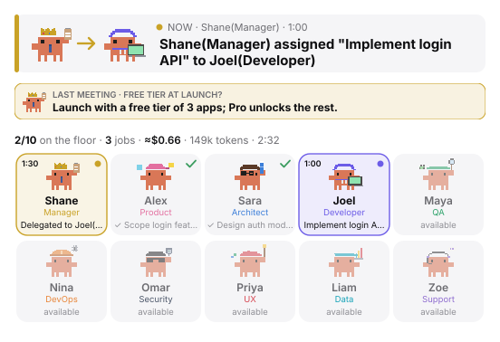
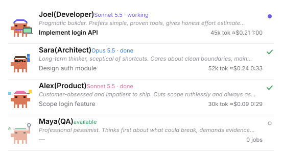
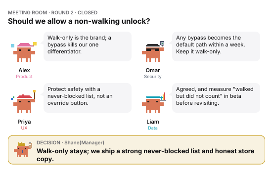
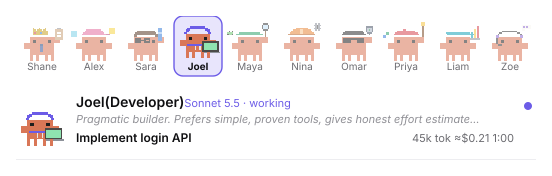

# Clawffice

**Your crab-run software agency, inside Claude Code.**

A virtual software agency inside Claude Code. Your session becomes **Shane(Manager)**, an Office Manager who turns every request into a ticket, hands it to the right specialist, and reports back with the model used, time taken, tokens and an approximate cost.

The team shows up as pixel crabs: on a band above the prompt and on an office floor panel, with a live headline of who is doing what.


## Contents

- [Installation guide](#installation-guide)
- [Features](#features)
- [The team](#the-team)
- [Commands](#commands)
- [Settings](#settings)
- [Costs](#costs)
- [Privacy](#privacy)
- [Development](#development)

## Installation guide

### Requirements

- Claude Code with plugin support (a version that has the `/plugin` command).
- A terminal session for the install step. The desktop app's Code tab can't run `/plugin install`, but once installed at the user scope the mod loads there too.

### 1. Install

At the prompt of a Claude Code terminal session, run:

```
/plugin install clawffice --marketplace Shanejoel95/clawffice
```

Then:

1. Answer `y` to **Add marketplace?** (`github:Shanejoel95/clawffice`).
2. Pick a scope. **User** makes it available in every session and project; **Project** limits it to the current one.
3. Set the options on the settings screen, or press Enter to keep the defaults (you can change them later).

You'll see `Installed clawffice. Plugin is now active.` The mod runs in that session straight away.

### 2. Check it works

1. Send any message. The reply opens with **OFFICE STATUS — Shane(Manager)**, and the crab band appears above the prompt.
2. Run `/office` to open the office floor.
3. Ask for something real, for example *"Alex, scope a login feature"*, and watch the crab walk while it works.

The first time a specialist works in a project, the mod creates `.office/log.md`, `.office/tickets/` and `.office/timesheet.md` there. Add `.office/` to that project's `.gitignore` if you don't want them committed.

### Update

```
claude plugin update clawffice
```

Then run `/reload-plugins` in an open session, or start a new one.

### Turn it off or remove it

- `/office off` switches the office persona off and hides the band; `/office on` brings it back. The setting is remembered.
- To remove it completely: `claude plugin uninstall clawffice`.

### Install from a local copy

To try changes before publishing, run Claude Code with the folder loaded:

```
git clone https://github.com/Shanejoel95/clawffice.git
claude --plugin-dir ./clawffice
```

## Features

### The office floor

`/office` opens a panel with everyone at a glance. Working desks light up in the person's colour with a timer, finished ones show a tick, and the headline at the top says who is doing what right now. The last meeting's decision stays pinned under it.



### Real timesheets, not guesses

When a specialist finishes, the mod records the actual duration, tokens and model, and an approximate cost:
- in `.office/timesheet.md`
- in `.office/log.md`
- in the Manager's ticket

**▸ Desk details** on the floor shows each person's personality, model, current task and running cost.



### Tickets and a real workflow

- **Tickets:** every task gets a ticket in `.office/tickets/OFFICE-NNN.md` with owner, status, acceptance criteria, files changed and handoff notes.
- **Workflow:** complex work goes Product → Architect → Developer → QA. Production changes add Security and DevOps.
- **Roles:** each specialist stays in their lane. The Developer escalates product questions to Product instead of deciding them.

### Meetings and debates

`/office debate <topic>` (or "hold a meeting on …") brings in 3–5 people whose roles and personalities disagree usefully:
1. They each give a position.
2. They rebut each other by name.
3. The Manager decides and records who was convincing and what risk is accepted.

The floor shows the meeting room as it happens.



### Your own staff

`/office staff` opens the staff editor. Pick someone by department, then change any of these:
- **Name**
- **Personality and house rules**: how they think, work and argue
- **Model**

Changes apply in every project from the next task. You can also just ask the Manager: *"rename Joel to Jordan and make him grumpy but brilliant"*.



### A live band above the prompt

The band shows the whole team, with working crabs walking, and the current headline with a timer. Choose `full`, `compact` (headline only) or `off` in the settings.

## The team

| Agent | Role | Default model | Personality |
|---|---|---|---|
| Shane(Manager) | Office Manager (your main session) | inherit | Decisive and fair; weighs cost, time and risk |
| Alex(Product) | Product Manager | sonnet | Customer-obsessed, cuts scope ruthlessly |
| Sara(Architect) | Software Architect | opus | Long-term thinker, sceptical of shortcuts |
| Joel(Developer) | Full-stack Developer | sonnet | Pragmatic builder, honest estimates |
| Maya(QA) | QA Engineer | sonnet | Professional pessimist, demands evidence |
| Nina(DevOps) | DevOps Engineer | sonnet | Reliability first, automates everything |
| Omar(Security) | Security Reviewer (read-only) | opus | Healthy paranoia, vetoes risky shortcuts |
| Priya(UX) | UX/UI Designer | sonnet | The user's advocate, fights clutter |
| Liam(Data) | Data & Optimization Analyst | opus | Numbers or it didn't happen |
| Zoe(Support) | Technical Writer / Support Lead | haiku | Counts the support tickets a decision creates |

Each specialist is a subagent type (`clawffice:developer`, `clawffice:qa`, …) with its own tools and remit.

## Commands

| Command | What it does |
|---|---|
| `/office` or `/office floor` | Open or close the office floor |
| `/office staff` | Open the staff editor |
| `/office debate <topic>` | Call a meeting on a topic |
| `/office roster` | Print the roster |
| `/office timesheet` | Show this project's timesheet |
| `/office off` / `/office on` | Turn the office persona off or on (remembered) |

## Settings

Set them in `/config`, or in `~/.claude/settings.json` under `pluginConfigs`:

```json
{ "pluginConfigs": { "clawffice": { "options": { "studioName": "Acme Labs", "band": "compact" } } } }
```

| Option | Default | Meaning |
|---|---|---|
| `studioName` | `Clawffice` | Name used in the panel, band, prompts and log |
| `band` | `full` | `full` (crabs and headline), `compact` (headline only), `off` |
| `autoOpenFloor` | `true` | Open the floor when a specialist starts or a meeting is called |
| `sequentialAgents` | `true` | Run specialists one at a time so handoffs are ordered and timesheets exact |

## Costs

Costs are estimates from token counts and list prices per million tokens, not a bill.

| Model | Input | Output |
|---|---:|---:|
| Opus | $5 | $25 |
| Sonnet | $3 | $15 |
| Haiku | $1 | $5 |
| Fable | $15 | $75 |

Cache reads count at 0.1× the input price and cache writes at 1.25×. To use different rates in a project, add `.office/rates.json` to it:

```json
{ "opus": [5, 25], "sonnet": [3, 15] }
```

## Privacy

Everything stays on your machine. Tickets, logs and the timesheet are files in your project, and staff settings live in Claude Code's plugin store. The mod sends nothing anywhere.

## Development

```
claude plugin validate .
claude plugin test .
claude --plugin-dir .
```

The screenshots in `docs/screenshots/` are drawn by the mod's own rendering code (`hooks/crabs.ts`) with sample data.

The crab sprites and walk cycle are adapted from [savvy-progress](https://github.com/johnnyvizz/claude-kit/tree/main/plugins/savvy-progress) (MIT).

## License

MIT
